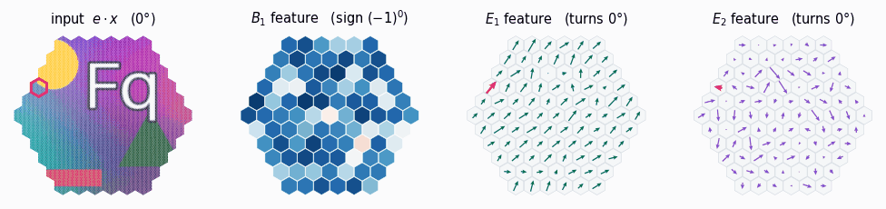
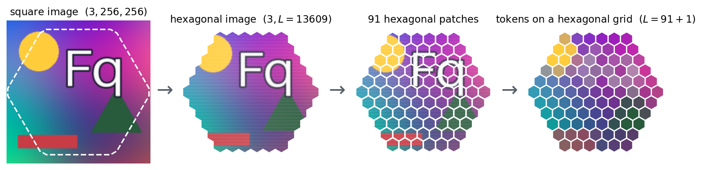
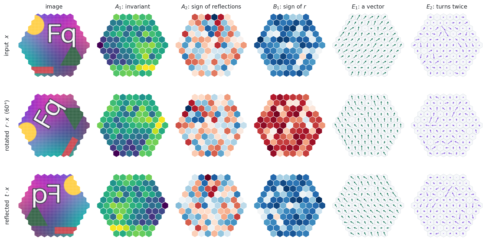
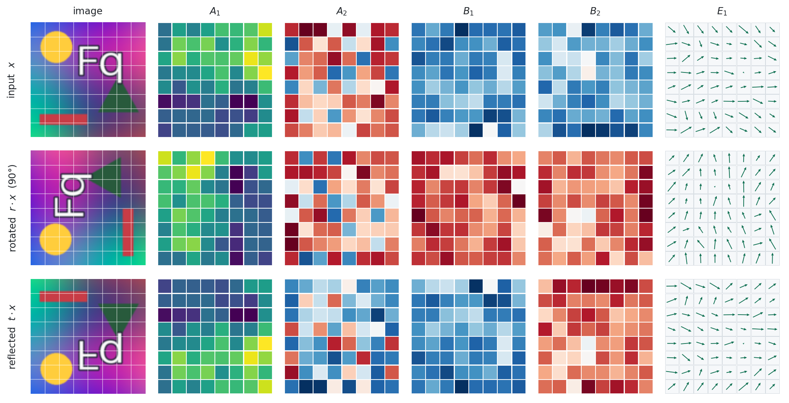
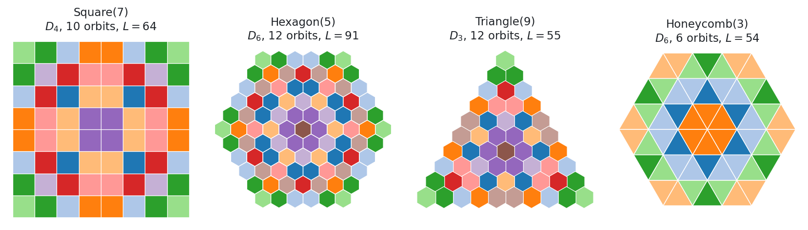
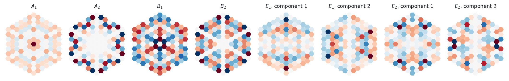
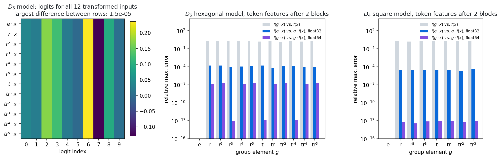

# EquiViT: build and test equivariant Vision Transformers

`equivit` is a PyTorch library for group-equivariant vision transformers. Every ViT layer
(patch embedding, positional encoding, attention, MLP, layer norm, class token, classification
head) has an equivariant version that is **not tied to one symmetry group**: a model is specified
by a group, a lattice the group acts on, and a number of channels per irreducible
representation. This generalizes the $\mathbb{Z}_2$-equivariant ViTs of
[flopping-for-flops](https://github.com/georg-bn/flopping-for-flops) and the $D_4$-equivariant
ViTs of [octic-vits](https://github.com/davnords/octic-vits) to arbitrary finite groups, and it
brings ViTs to **hexagonal images** with exact $D_6$ symmetry.

<p align="center">
  
</p>
<p align="center"><sub>
A D<sub>6</sub>-equivariant ViT on a hexagonal image, rotated through 0°, 60°, …, 300°. The
features do not change arbitrarily. A B<sub>1</sub> feature changes sign at every 60° step, an
E<sub>1</sub> feature is a vector that turns with the image, and an E<sub>2</sub> feature turns
twice as fast. The highlighted token is the same patch of the image in every frame.
</sub></p>

---

## Contents

- [Hexagonal images](#hexagonal-images)
- [How features transform](#how-features-transform)
- [Installation](#installation)
- [Quickstart](#quickstart)
- [Lattices and group actions](#lattices-and-group-actions)
- [Equivariant layers](#equivariant-layers)
- [Checking equivariance](#checking-equivariance)
- [Training](#training)
- [Package layout](#package-layout)
- [Related work](#related-work)

## Hexagonal images

A square pixel grid has only the symmetries of a square ($D_4$: rotations by $90°$ and four
reflections). A hexagonal grid has the symmetries of a hexagon ($D_6$: rotations by $60°$ and six
reflections), so a hexagonal ViT can be made exactly equivariant to a finer set of rotations.

`equivit` resamples a square image onto a hexagonal grid of pixels with
`CropAndInterpolate` (bilinear), cuts it into hexagonal patches with `HexPatches`, and embeds
each patch as one token. The tokens again sit on a hexagonal grid, so the $D_6$ action on the
image induces an action on the token sequence.

<p align="center">
  
</p>

Because all of these grids are closed under $D_6$, rotating a hexagonal image by $60°$ is an
exact permutation of its pixels. Nothing is interpolated, so equivariance holds to floating-point
precision rather than approximately.

## How features transform

Every hidden feature in an `equivit` model is a **list of tensors, one per irreducible
representation (irrep)** of the group, each of shape $(B, L, C_i, d_i)$: batch, tokens, channels
of irrep $i$, and the dimension $d_i$ of irrep $i$. When the input is transformed by a group
element $g$, the tokens are permuted the way $g$ moves the patches, and each feature vector is
multiplied by the matrix $\rho_i(g)$ of its irrep:

$$f(g\cdot x)_{\,g\cdot p} \;=\; \rho_i(g)\, f(x)_p .$$

For $D_6$, with $r$ the rotation by $60°$ and $t$ a reflection:

| irrep | $d_i$ | under $r$ ($60°$) | under $t$ (reflection) | looks like |
|---|---|---|---|---|
| $A_1$ | 1 | $+1$ | $+1$ | a scalar that only moves with the image |
| $A_2$ | 1 | $+1$ | $-1$ | a scalar that flips sign under reflections |
| $B_1$ | 1 | $-1$ | $+1$ | a scalar that flips sign at every $60°$ step |
| $B_2$ | 1 | $-1$ | $-1$ | a scalar that flips sign under both |
| $E_1$ | 2 | rotation by $60°$ | reflection | a vector (arrow) |
| $E_2$ | 2 | rotation by $120°$ | reflection | an arrow that turns twice as fast |

The figure shows one channel of each irrep after two transformer blocks of a randomly
initialized $D_6$ model, for an image $x$, its rotation $r\cdot x$ and its reflection $t\cdot x$.
Compare the rows: the $A_1$ map is carried along with the image, $A_2$ changes colour (sign) under
the reflection only, $B_1$ under the rotation only, and the $E_1$ and $E_2$ arrows turn by $60°$
and $120°$.

<p align="center">
  
</p>

The same holds on square images with $D_4$, where $r$ is the rotation by $90°$ and $E_1$ is a
vector that turns with the image:

<p align="center">
  
</p>

Only $A_1$ features are invariant. The classification head (`InvariantClassificationHead`)
reads the class token from them, so the logits are unchanged by every group element.

## Installation

```bash
git clone https://github.com/michael-960/equivit
cd equivit
python -m pip install -e .
```

Python $\geq 3.12$ is required (tested on 3.12.13).

## Quickstart

### A $D_4$-equivariant ViT for square images

```python
import torch
from equivit import nn as eqnn
from equivit.models import OcticViTBackbone, OcticViTBackboneConfig, OcticTokenizeConfig

backbone = OcticViTBackbone(OcticViTBackboneConfig(
    dims={"A1": 18, "A2": 18, "B1": 18, "B2": 18, "E1": 36},   # channels per irrep of D4
    depth=4,
    subgroup=("D", 4, 0),                                       # keep the full D4 symmetry
    tokenizer_config=OcticTokenizeConfig(img_size=64, patch_size=8, in_channels=3),
    transformer_block_config=eqnn.EquivariantTransformerBlockConfig(
        attn_type="coupled", num_heads=3,
        homogeneous_space_copies=[72, 0, 0, 0, 0, 0, 0, 0],    # one entry per subgroup class of D4
        activation="gelu"),
))
head = eqnn.InvariantClassificationHead(dim=108, num_logits=10)   # dim = sum of the channels
model = torch.nn.Sequential(torch.nn.Flatten(-2), backbone, head)

x = torch.randn(2, 3, 64, 64)
print(model(x).shape)                                                     # torch.Size([2, 10])
print((model(x) - model(torch.rot90(x, 1, dims=(-2, -1)))).abs().max())   # ~1e-7
print((model(x) - model(torch.flip(x, dims=(-1,)))).abs().max())          # ~1e-7
```

The backbone returns one tensor per irrep. Each has $64 + 1$ tokens: the $8 \times 8$ patches and
the class token, which comes last.

```python
import equivit

for name, f in zip(equivit.D4.real_irreps(), backbone(x.flatten(-2))):
    print(name, tuple(f.shape))
# A1 (2, 65, 18, 1)   A2 (2, 65, 18, 1)   B1 (2, 65, 18, 1)   B2 (2, 65, 18, 1)   E1 (2, 65, 36, 2)
```

### A $D_6$-equivariant ViT for hexagonal images

`build_honey_regular` assembles the whole pipeline: `CropAndInterpolate` onto `HexPatches`,
the hexagonal tokenizer, the transformer blocks and the invariant head.

```python
from equivit.models import build_honey_regular

model = build_honey_regular(
    img_size=256, N1=9, N2=9,           # 9+1 patches per side of the hexagon, 9+1 pixels per patch side
    in_channels=3, depth=4, base_dim=12, mlp_ratio=4,
    subgroup=("D", 6, 0), attn_type="coupled", num_heads=3,
    activation="gelu", num_logits=10,
)
img = torch.randn(2, 3, 256, 256)
print(model(img).shape)                 # torch.Size([2, 10])
```

The model is a named `Sequential` with parts `preprocess`, `backbone` and `head`. A $60°$
rotation of the hexagonal image is a permutation of its pixels:

```python
from equivit.geometry import HexPatches

lattice = HexPatches(N1=9, N2=9)
hex_img = model.preprocess(img)                     # (2, 3, 66367): the image on hexagonal pixels
r = equivit.D6["r"]                                 # rotation by 60 degrees
rot_img = hex_img[..., lattice.action(r.inv())]     # (r.x)[q] = x[r^-1 q]

logits = model.head(model.backbone(hex_img))
logits_r = model.head(model.backbone(rot_img))
print((logits - logits_r).abs().max())              # ~1e-7
```

Configurations for $D_4$, $D_6$ and all of their subgroups ($C_1, C_2, C_4, D_1, D_2$ and
$C_1, C_2, C_3, C_6, D_1, D_2, D_3$) at four sizes are in `experiments/conf/model/`.

## Lattices and group actions

`equivit.geometry` contains a small representation-theory backend (`CyclicGroup`,
`DihedralGroup` and their real irreps, subgroups, homogeneous spaces, restriction of
representations) and the lattices a group acts on. A `Lattice` is a finite set of points together
with a `GroupAction` that permutes them. The figure colours each lattice by the orbits of its
symmetry group: points of the same colour are mapped to each other by the group.

<p align="center">
  
</p>

```python
from equivit.geometry import Hexagon

hexagon = Hexagon(5)
print(hexagon.L)                          # 91 points
print(hexagon.action.group)               # DihedralGroup(6)
print(len(hexagon.action.orbits()))       # 12 orbits
print(hexagon.action(equivit.D6["r"]))    # the permutation of the 91 points by a 60 degree rotation
```

Any lattice can display a tensor of shape $(3, L)$ or $(L,)$ with `lattice.colormesh(ax, x)`.

## Equivariant layers

`equivit.nn` holds the layers. All of them take and return the per-irrep list of tensors, so they
compose like ordinary PyTorch modules.

| layer | what it does |
|---|---|
| `EquivariantPatchEmbed` | linear map from the pixels of a patch to each irrep, constrained by the group's action on the patch |
| `EquivariantPositionalEncoding`, `EquivariantInducedPositionalEncoding` | positional encodings that commute with the group's action on the token grid |
| `EquivariantCoupledAttention` | multi-head self-attention over all irreps together, so irreps can interact |
| `EquivariantIrrepwiseAttention` | separate multi-head self-attention per irrep |
| `BundleAttention` | equivariant multi-head self-attention whose heads are permuted by the group |
| `EquivariantMLP`, `EquivariantLinear`, `EquivariantLayerNorm` | MLP, linear and normalization layers acting on the per-irrep format |
| `EquivariantTransformerBlock` | norm, attention, layer scale and MLP, assembled from the above |
| `SymmetryRestriction`, `SymmetryCorestriction` | change the symmetry group to a subgroup and back |
| `AppendClassToken`, `InvariantClassificationHead` | class token in the $A_1$ channels and an invariant read-out |
| `CropAndInterpolate` | resample a square image onto any lattice |

`equivit.nn.vanilla` contains non-equivariant versions of the same layers for baselines.

The patch embedding shows the constraint directly. Below are the filters of an
`EquivariantPatchEmbed` on one hexagonal patch, one per irrep of $D_6$, with random weights. The
$A_1$ filter is unchanged by every rotation and reflection of the patch. Each of the others
changes sign or mixes its two components exactly as its irrep prescribes.

<p align="center">
  
</p>

## Checking equivariance

`equivit.nn.act_on_tensors(g, xs)` multiplies each tensor of the per-irrep list by $\rho_i(g)$.
Together with the lattice permutation this gives the full test of the formula above:

```python
from equivit.nn import act_on_tensors

tokens = lattice.hex1                                 # the hexagonal grid the patch tokens live on
f = model.backbone(hex_img)                           # features of x
f_r = model.backbone(rot_img)                         # features of r.x
expected = [t[:, :-1][:, tokens.action(r.inv())]      # rho(r) f(x), patch tokens moved by r
            for t in act_on_tensors(r, f)]
print(max((a[:, :-1] - b).abs().max().item() for a, b in zip(f_r, expected)))   # ~1e-6
```

Run over every element of the group, the logits of a $D_6$ model agree to $10^{-5}$, and the hidden
features satisfy the formula to float32 precision. The grey bars show how much the features
change if $f(x)$ is compared with $f(g\cdot x)$ directly, without moving the tokens and without
$\rho(g)$.

<p align="center">
  
</p>

`tests/` contains an equivariance test for every layer (`tests/equivariance/`) and for the group
and representation backend:

```bash
python -m pytest tests/
```

## Training

`equivit.training` is a [PyTorch Lightning](https://lightning.ai) and
[Hydra](https://hydra.cc) harness for image classification. From `experiments/`:

```bash
python -m equivit.training train-classifier --config-dir=conf --config-name=config \
    data=patternnet_aug model=honey/D6/a/tiny
```

Any config value can be overridden on the command line, for example `trainer.max_epochs=10` or
`~loggers.mlflow` to train without MLflow. To write the predefined model configs to a new
directory:

```bash
python -m equivit.training gen-model-configs conf
```

`experiments/README.md` describes the SLURM setup and the datasets (PatternNet, PCam, Food-101,
CIFAR).

## Package layout

```
src/equivit/
├── geometry/          groups, irreps, subgroups, group actions
│   └── lattices/      Square, Hexagon, Triangle, Honeycomb; HexPatches, HoneyTriangle
├── nn/                equivariant layers (per-irrep list format); vanilla/ for baselines
├── models/            OcticViTBackbone (D4, square), HoneyViTBackbone (D6, hexagonal), factories
├── training/          Lightning + Hydra classification harness
└── data/              datasets and transforms
```

The API reference is built with Sphinx from `docs/` (`make -C docs html`).

## Related work

- G. Bökman et al., *Flopping for FLOPs*: $\mathbb{Z}_2$-equivariant ViTs,
  [github.com/georg-bn/flopping-for-flops](https://github.com/georg-bn/flopping-for-flops).
- D. Nordström et al., *Stronger ViTs with octic equivariance*,
  [arXiv:2505.15441](https://arxiv.org/abs/2505.15441),
  [github.com/davnords/octic-vits](https://github.com/davnords/octic-vits).
